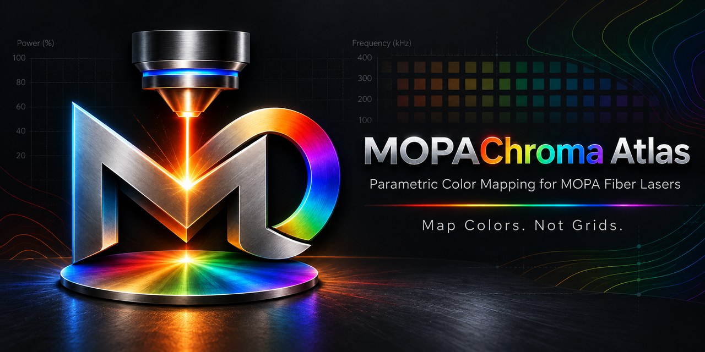
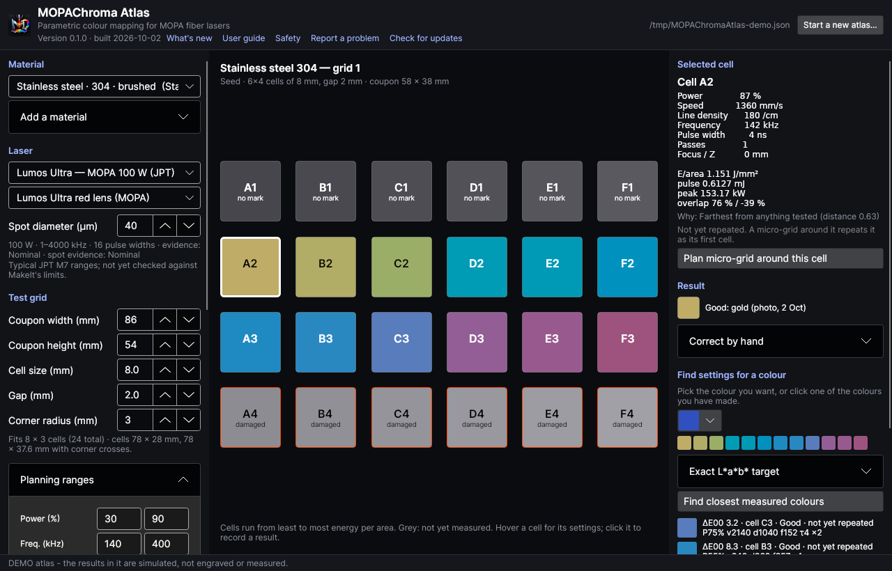

# MOPAChroma Atlas

*An Isotope NW tool.*

Parametric colour mapping for MOPA fiber lasers. MOPAChroma Atlas plans colour test
grids for a material, records what each cell produced, and answers the question
**"what settings give me this colour?"** — without the hundreds of redundant cells a
conventional power × speed sweep burns.

Built for the WeCreat Lumos Ultra (60 W and 100 W JPT MOPA) and its MakeIt software;
the settings it proposes are in MakeIt's own units.



> Status: first release (0.1). Working on real hardware (stainless and titanium): planning
> grids within per-material ranges and a hard heat limit, sending them to the Lumos Ultra
> placed on its camera picture, reading the engraved card back automatically, reading every
> numbered grid on a whole sheet from one picture, and exporting your colours as MakeIt
> materials. Still to be proven: the LightBurn library with the Ultra. See [TODO.md](TODO.md).

**Download:** [latest release](https://github.com/LeeGillie/MOPAChromaAtlas/releases/latest)
(one zip per platform, nothing to install). **New here? Read the
[User Guide](docs/USER-GUIDE.md)** ([PDF](https://github.com/LeeGillie/MOPAChromaAtlas/releases/latest/download/MOPAChroma-Atlas-User-Guide.pdf)):
the ideas in plain words, and step-by-step recipes. **What changed:** [CHANGELOG](CHANGELOG.md).

## How it works

1. **Pick a material** — grade, finish and form included, because 304 brushed and 316
   mirror colour differently, and so do a sheet and a business card.
2. **Plan a seed grid.** Cells are spread across the *physics* of the process — energy
   per area, energy per pulse, pulse width, pulse overlap — so no two cells are
   physically equivalent. Unlike MakeIt's colour test (pulse width 6, speed 800, line
   density 5000, one pass, only power and frequency varied), every setting can vary, within
   **planning ranges** you set per material.
3. **Send it to the laser.** The job is drawn on the laser camera's picture: drag it
   onto your blank, arm it, press Start on the machine.
4. **Read it back.** The finished card is photographed and opens with the grid already
   on the squares; check each cell's suggested result (good, no mark, uneven, damaged)
   and its colour, and add it to the atlas. A good USB camera, with the light at an
   angle you choose, gives truer colour (a flatbed scanner can wash oxide colours out).
5. **Plan a refinement grid.** The planner skips regions already shown to be dead or
   already mapped, and puts cells where colour changes, where the usable region ends,
   and towards colours the atlas does not have yet. It never repeats a setting. Every
   cell says why it was chosen. A **micro-grid** sweeps finely around a cell you like,
   repeats it once to check the colour comes back, and is only as big as it needs to be.
6. **Read the whole sheet.** Every grid carries its number as a row of dots (and "Grid 12"
   for people); a sharp picture of a full sheet can find and read every grid on it at once,
   and the better colours replace the camera's estimates. (On camera photos the automatic
   finding often misses in 0.1; placing a grid by hand in the picture always works.)
7. **Use the colours.** Pick a colour to get the settings that made it (repeated colours
   first), browse the palette, and export it: as **MakeIt materials** (import once, then pick
   a colour by name from MakeIt's Material list and every setting is filled in), as a MakeIt
   palette project (a labelled square per colour), or as a LightBurn material library.

See [docs/DESIGN.md](docs/DESIGN.md) for the reasoning.

## Safety

**Read [SAFETY.md](SAFETY.md) before using MOPAChroma Atlas.** It controls a Class 4 laser,
safety is your responsibility, and the software comes with no warranty. The program shows the
notice on first start and asks you to accept it.

The Lumos Ultra is a **Class 4 laser**. MOPAChroma Atlas talks to it directly, so it
is built never to fire it on its own:

- A job is only **armed**; it runs when you press **Start on the machine** (or tick a
  confirmation and press *Start from here*).
- The **door must be confirmed closed** before a job is sent.
- **Every job is heat-checked from its own G-code before it is sent**: the energy each
  square millimetre would receive, all passes included. Over 45 J/mm² anywhere and it is
  refused. The planner never plans above 40 J/mm² (less once results show where damage
  starts). Added after early planned cells cut through a stainless sheet.
- A job cannot be sent until you have **seen where it will engrave** on the calibrated
  camera picture (or deliberately ticked that you checked the position another way).
- Nothing in the apps sends raw machine commands (the device API's raw-command endpoint
  bypasses the lid interlock; the library's method for it demands an explicit
  acknowledgement and no window offers it).

Stay with the machine while it runs, wear eyewear rated for 1064 nm, use extraction, and
keep the machine's own stop button within reach. **Use at your own risk**: this is
unofficial software, not made, endorsed or supported by WeCreat (see the licence's
warranty disclaimer).

## What is confirmed on hardware

| Works on the authors' Lumos Ultra | Not yet confirmed |
|---|---|
| Planning grids; generating the job G-code (MakeIt's own encoding) | Stop job from the app (the machine's stop button always works) |
| Upload, arm, and the machine's Start button | Framing (the red-dot outline) |
| Following the job and photographing the finished card | Scanning straight from a flatbed (WIA); a USB camera on every PC |
| Camera calibration; placing a job on the camera picture | Cabin light control |
| Reading a card back with the grid placed automatically | LightBurn using the exported library with the Ultra |
| Grid number dots and labels; reading a whole sheet from one picture (stainless and titanium) | Engraving a shape from an exported MakeIt material and comparing the colour |
| MakeIt materials: import, pick by name, every Fill setting applied, re-import updates in place (MakeIt 3.0.6) | |
| MakeIt palette project opens in MakeIt 3.0.6 with every square's settings | |
| Per-material planning ranges; the heat limit refusing over-hot jobs | |

## Known limitations in 0.1

- **Finding grids automatically in camera photos** often fails (it works on sharp,
  high-resolution scans). Placing the grid by hand on the picture works reliably and is
  quick; better recognition is planned.
- **Flatbed scanners** can make oxide colours look washed out and flat on brushed or
  polished metal. A USB camera with the light at an angle gave much truer colour.
- **LightBurn** export is untested with the Ultra (whether LightBurn sends pulse width and
  frequency to it).
- **Laser cabin light** cannot be set from Atlas yet.
- Tested on Windows 11 with a Lumos Ultra 100 W MOPA; other platforms are built but not yet
  tried with a laser (below).

## Supported platforms

Every release has a self-contained zip for seven platforms: unzip and run, no .NET or other
runtime to install, no administrator rights. Each zip holds the program, the user guide PDF,
a README and the licence. The program shows its version under the title, shows its release
notes (*What's new*), and offers to update itself in place when a newer release is out.

| Platform | Download | Status |
|---|---|---|
| Windows 10 and 11, 64-bit | `win-x64` | **Confirmed** on the authors' PCs with the Lumos Ultra |
| Windows on ARM | `win-arm64` | Built and packaged; not yet tried |
| Windows, 32-bit | `win-x86` | Built and packaged; not yet tried |
| macOS 12 or later, Apple silicon | `osx-arm64` | Built, signed ad hoc and smoke-tested in CI; not yet tried with a laser |
| macOS 12 or later, Intel | `osx-x64` | Built and packaged; not yet tried |
| Linux, 64-bit (X11 or XWayland desktop) | `linux-x64` | Program and window tested in CI and in development; not yet tried with a laser |
| Linux on ARM (Raspberry Pi 4/5) | `linux-arm64` | Built and packaged; not yet tried |

What depends on the platform:

| Feature | Windows | macOS | Linux |
|---|---|---|---|
| Planning, atlas, palette, MakeIt and LightBurn exports, reading cards from image files | Yes | Yes | Yes |
| Laser over USB (`192.168.42.1`) | Confirmed | Not yet tried (needs the laser's USB network adapter to work on macOS) | Not yet tried |
| Laser over Wi-Fi | Should work; not yet tried | Not yet tried | Not yet tried |
| USB camera | DirectShow / Media Foundation (confirmed) | AVFoundation (not yet tried) | V4L2 (not yet tried) |
| Scanning from inside Atlas | WIA scanners | Not available: scan with the scanner's own app into a watched folder | SANE (`scanimage`), not yet tried |
| Watched scan folder, open file, drag and drop | Yes | Yes | Yes |

Reports from other platforms are very welcome: open a GitHub issue saying what worked.

## Building from source

```powershell
dotnet run --project src\MOPAChromaAtlas            # your atlas, in your user profile
dotnet run --project src\MOPAChromaAtlas -- --demo  # throwaway atlas with SIMULATED results
dotnet test MOPAChromaAtlas.slnx                     # all tests
```

Requires the .NET 10 SDK (Visual Studio 2026 includes it). `publish.ps1` / `publish.sh` build
the release zips locally; the release workflow (`.github/workflows/release.yml`) builds them
for a tagged version. Release steps: put the new version in `Directory.Build.props`, add its
section at the top of `CHANGELOG.md`, push, then tag `vX.Y.Z` and push the tag.

## Feedback, help and bug reports

- **Comments, discussion, questions and ideas:** the Facebook group
  *Lumos Ultra Owners & Makers — Independent User Group*. Everyone is welcome.
- **Bug reports and feature requests:** please open an issue here on GitHub
  ([Issues](https://github.com/LeeGillie/MOPAChromaAtlas/issues)), so each one is tracked.
  Say what you did, what happened, your platform and Atlas version (top of the main window),
  and attach a picture or the job if it helps.

This is a free project maintained in spare time: there is no guaranteed support.

## Licence

[MIT](LICENSE) © 2026 Lee Gillie. Provided as is, without warranty: see [SAFETY.md](SAFETY.md).
Open-source components and their licences: [THIRD-PARTY-NOTICES.md](THIRD-PARTY-NOTICES.md).
WeCreat, Lumos, Lumos Ultra and MakeIt are trademarks of their owners; LightBurn is a trademark
of LightBurn Software, LLC. Not affiliated with WeCreat or LightBurn Software; see
[`src/LumosUltra.Client/PROVENANCE.md`](src/LumosUltra.Client/PROVENANCE.md) for how the
laser's interface was learned.
